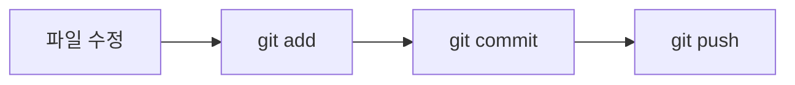

<!-- 맨 위 물결 배너 -->


<div align="center">

<!-- 타자 치듯 바뀌는 문장 -->
<a href="https://github.com/steve5781-a11y">
  
</a>

<br>


</div>

<br>

## 🙋 About Me

- 🐍 **파이썬**으로 프로그래밍을 배우고, 배운 것을 바로 작은 프로젝트로 만들어 봐요.
- ✋ 웹캠으로 **손·포즈를 인식하는 AI**에 관심이 많아요.
- 🌐 만든 프로젝트는 **GitHub Pages**로 배포해서 누구나 브라우저에서 써 볼 수 있게 해요.
- 🎓 **피지컬 AI 수업**을 들으며 컴퓨터 비전과 포즈 인식을 실습하고 있어요. (2026)

<br>

## 🛠 Skills

<div align="center">

**Language**


**AI · Vision**


**Tools · Deploy**


</div>

<br>

## 💻 개발 환경

| 구분 | 사용해 본 것 |
|:----|:----|
| 운영체제 | Windows 11 |
| 코드 편집기 | Visual Studio Code |
| 언어 · 실행 환경 | Python 3.14 · Node.js 24 · 웹 브라우저 (Chrome) |
| 버전 관리 | Git · GitHub CLI (`gh`) · GitHub Desktop |
| 배포 | GitHub Pages · GitHub Actions (push하면 자동 배포) |
| 장치 | 웹캠으로 실시간 영상 입력 받기 |

<br>

## 🚀 Projects

<div align="center">

<a href="https://github.com/steve5781-a11y/mediapipe-hand"></a>
<a href="https://github.com/steve5781-a11y/myeongun-saju"></a>
<a href="https://github.com/steve5781-a11y/snake"></a>
<a href="https://github.com/steve5781-a11y/shooting-game"></a>

</div>

### ✋ mediapipe-hand · 손 제스처 인식 + 이모지 효과
> 웹캠으로 손을 실시간 인식하고, **내가 만든 손동작을 직접 학습**시켜 알아보면 손에서 이모지가 날아가요.

- **한 일:** 손동작 녹화 → 학습 → 실시간 인식까지 전체 과정 구현, 학습한 모델을 웹용으로 바꿔 브라우저에서 바로 실행
- **기술:** Python · MediaPipe · OpenCV · PyTorch · NumPy · JavaScript
- 🌐 [웹 데모 바로 가기](https://steve5781-a11y.github.io/mediapipe-hand/) · 📁 [저장소](https://github.com/steve5781-a11y/mediapipe-hand)

### 🔮 myeongun-saju · 명운당 사주 × MBTI 운세 웹앱
> 만세력으로 사주팔자를 계산하고 **MBTI · 혈액형 · 별자리**를 겹쳐 보는 운세 웹앱이에요. 친구 말투로 바뀌는 **팩폭 모드**도 있어요.

- **한 일:** 사주 계산, 오늘의 운세, 궁합 화면 구현, 입력 정보는 브라우저 안에서만 계산하도록 설계
- **기술:** JavaScript · HTML · CSS · GitHub Actions (자동 배포)
- 🌐 [웹앱 바로 가기](https://steve5781-a11y.github.io/myeongun-saju/) · 📁 [저장소](https://github.com/steve5781-a11y/myeongun-saju)

### 🐍 snake · 포즈로 조종하는 뱀 게임
> 웹캠 앞에서 **몸을 움직여** 뱀을 조종하는 브라우저 게임이에요. 피지컬 AI 수업 실습으로 만들었어요.

- **한 일:** Teachable Machine으로 위·아래·왼쪽·오른쪽·정지 포즈 학습, 확신도 80% 이상일 때만 명령으로 인정
- **기술:** JavaScript · HTML · TensorFlow.js · Teachable Machine
- 📁 [저장소](https://github.com/steve5781-a11y/snake)

### 🎯 shooting-game · 사격 게임 & 쭈꾸르 주식왕
> 브라우저에서 바로 하는 **사격 게임**과, 뉴스에 따라 주가가 움직이는 **주식 거래 게임**이에요.

- **한 일:** 장 시간(09:00~16:00)에만 거래, 뉴스 이유가 붙는 무작위 주가 변동, 커뮤니티 게시판 구현
- **기술:** JavaScript · HTML · CSS
- 🌐 [사격 게임](https://steve5781-a11y.github.io/shooting-game/) · 🌐 [주식 게임](https://steve5781-a11y.github.io/shooting-game/stock.html) · 📁 [저장소](https://github.com/steve5781-a11y/shooting-game)

<br>

## 📂 Repositories

| 저장소 | 언어 | 설명 | 데모 |
|:------|:----:|:-----|:----:|
| [mediapipe-hand](https://github.com/steve5781-a11y/mediapipe-hand) | Python | 손 제스처 인식 + 이모지 효과 | [🌐](https://steve5781-a11y.github.io/mediapipe-hand/) |
| [myeongun-saju](https://github.com/steve5781-a11y/myeongun-saju) | JavaScript | 사주 × MBTI × 혈액형 운세 웹앱 | [🌐](https://steve5781-a11y.github.io/myeongun-saju/) |
| [snake](https://github.com/steve5781-a11y/snake) | HTML | 포즈로 조종하는 뱀 게임 | - |
| [shooting-game](https://github.com/steve5781-a11y/shooting-game) | HTML | 사격 게임 & 주식 거래 게임 | [🌐](https://steve5781-a11y.github.io/shooting-game/) |
| [steve5781-a11y](https://github.com/steve5781-a11y/steve5781-a11y) | Markdown | 지금 보고 있는 프로필 | - |

<br>

## 🤝 협업

- 지금까지의 프로젝트는 모두 **혼자 기획부터 개발, 배포까지** 진행했어요.
- 다음 목표는 **팀 프로젝트**에서 브랜치 · Pull Request · 코드 리뷰로 함께 개발해 보는 거예요.

<br>

## 📜 자격증

- 아직 취득한 자격증은 없어요. 공부하면서 차근차근 준비할 예정이에요.

<br>

## 📚 공부 기록

| 주제 | 내용 | 상태 |
|:----|:----|:----:|
| 파이썬 기초 | 변수, 출력, 자료형, 계산 | ✅ |
| 입력과 문자열 | `input`, 형변환, 문자열 정리 | ✅ |
| 조건문 · 반복문 | `if` · `elif` · `else`, `for` (별 트리 찍기) | ✅ |
| Git · 마크다운 | `add` → `commit` → `push`, README 작성 | ✅ |
| 함수 | `def`, 매개변수, `return` | 🔥 공부 중 |
| 미니 프로젝트 | 학교 매점 재고 메모 앱 (tkinter, 파일 저장) | 🔥 만드는 중 |

<br>

## 📊 GitHub Stats

<div align="center">


</div>

<br>

## 📝 마크다운 문법 완벽 가이드

공부하면서 정리한 마크다운 문법이에요. 항목을 누르면 **쓰는 법**과 **결과**가 함께 보여요.

<details>
<summary><b>1. 제목 (Heading)</b></summary>
<br>

`#` 개수로 크기를 정해요. 1개가 가장 크고 6개까지 쓸 수 있어요. `#` 뒤에는 꼭 한 칸 띄어요.

```markdown
# 제목 1
## 제목 2
### 제목 3
#### 제목 4
##### 제목 5
###### 제목 6
```

# 제목 1
## 제목 2
### 제목 3
#### 제목 4
##### 제목 5
###### 제목 6

`#` 대신 글 아래에 `===` 를 쓰면 제목 1, `---` 를 쓰면 제목 2가 돼요.

```markdown
큰 제목
======

작은 제목
------
```

</details>

<details>
<summary><b>2. 문단과 줄바꿈</b></summary>
<br>

엔터를 한 번만 치면 줄이 바뀌지 않고 앞줄에 붙어요. 줄을 바꾸는 방법은 세 가지예요.

```markdown
줄 끝에 띄어쓰기 두 칸을 넣으면··
줄이 바뀌어요. (·는 띄어쓰기 한 칸)

빈 줄을 넣으면 문단이 나뉘어요.

<br> 태그로도 줄을 바꿀 수 있어요.<br>이렇게요.
```

줄 끝에 띄어쓰기 두 칸을 넣으면  
줄이 바뀌어요.

빈 줄을 넣으면 문단이 나뉘어요.

<br> 태그로도 줄을 바꿀 수 있어요.<br>이렇게요.

</details>

<details>
<summary><b>3. 글자 강조</b></summary>
<br>

```markdown
*기울임* 또는 _기울임_
**굵게** 또는 __굵게__
***굵게 + 기울임***
~~취소선~~
<ins>밑줄</ins>
H<sub>2</sub>O (아래 첨자)
x<sup>2</sup> (위 첨자)
```

*기울임* 또는 _기울임_  
**굵게** 또는 __굵게__  
***굵게 + 기울임***  
~~취소선~~  
<ins>밑줄</ins>  
H<sub>2</sub>O (아래 첨자)  
x<sup>2</sup> (위 첨자)

> 한글 사이에 쓸 때는 `이건 **중요** 해요` 처럼 앞뒤를 띄어 쓰는 게 안전해요.

</details>

<details>
<summary><b>4. 인용문</b></summary>
<br>

```markdown
> 첫 번째 인용
>> 두 번째 인용
>>> 세 번째 인용
```

> 첫 번째 인용
>> 두 번째 인용
>>> 세 번째 인용

</details>

<details>
<summary><b>5. 알림 상자 (GitHub 전용)</b></summary>
<br>

```markdown
> [!NOTE]
> 참고할 내용

> [!TIP]
> 알아 두면 좋은 내용

> [!IMPORTANT]
> 꼭 알아야 하는 내용

> [!WARNING]
> 주의할 내용

> [!CAUTION]
> 위험한 내용
```

> [!NOTE]
> 참고할 내용

> [!TIP]
> 알아 두면 좋은 내용

> [!IMPORTANT]
> 꼭 알아야 하는 내용

> [!WARNING]
> 주의할 내용

> [!CAUTION]
> 위험한 내용

</details>

<details>
<summary><b>6. 목록</b></summary>
<br>

**순서 있는 목록:** 숫자를 아무렇게나 써도 첫 번호부터 차례대로 매겨져요.

```markdown
1. 첫째
1. 둘째
1. 셋째
```

1. 첫째
1. 둘째
1. 셋째

**순서 없는 목록:** `-`, `*`, `+` 모두 같아요. 띄어쓰기 2칸을 넣으면 한 단계 안으로 들어가요.

```markdown
- 과일
  - 사과
    - 부사
  - 바나나
- 채소
```

- 과일
  - 사과
    - 부사
  - 바나나
- 채소

**체크리스트**

```markdown
- [x] 끝난 일
- [ ] 해야 할 일
```

- [x] 끝난 일
- [ ] 해야 할 일

</details>

<details>
<summary><b>7. 코드</b></summary>
<br>

**문장 속 코드:** 백틱(\`) 하나로 감싸요.

```markdown
`print()` 함수로 출력해요.
```

`print()` 함수로 출력해요.

**코드 블록:** 백틱 세 개로 감싸고, 뒤에 언어 이름을 쓰면 색이 입혀져요.

````markdown
```python
def hello(name):
    print(f"안녕, {name}!")
```
````

```python
def hello(name):
    print(f"안녕, {name}!")
```

**바뀐 부분 보여 주기:** 언어 이름에 `diff` 를 쓰면 `+` 줄은 초록, `-` 줄은 빨강이 돼요.

````markdown
```diff
- print("hello")
+ print("안녕하세요")
```
````

```diff
- print("hello")
+ print("안녕하세요")
```

</details>

<details>
<summary><b>8. 링크</b></summary>
<br>

```markdown
[구글](https://google.com)
[마우스를 올려 보세요](https://google.com "구글로 가기")
<https://github.com>

[참조 링크][1]

[1]: https://www.markdownguide.org

[위로 가기](#-about-me)
```

[구글](https://google.com)  
[마우스를 올려 보세요](https://google.com "구글로 가기")  
<https://github.com>

[참조 링크][1]

[1]: https://www.markdownguide.org

[위로 가기](#-about-me)

> 문서 안의 제목으로 이동할 때는 `#제목` 처럼 써요. 띄어쓰기는 `-` 로, 영어는 소문자로 바꿔요.

</details>

<details>
<summary><b>9. 이미지</b></summary>
<br>

링크 앞에 `!` 를 붙이면 이미지가 돼요. 크기를 바꾸려면 HTML `` 태그를 써요.

```markdown


```


**이미지에 링크 걸기**

```markdown
[](https://github.com)
```

[](https://github.com)

</details>

<details>
<summary><b>10. 표</b></summary>
<br>

`|` 로 칸을 나누고, 둘째 줄에 `---` 를 써요. `:` 위치로 정렬을 정해요.

```markdown
| 왼쪽 정렬 | 가운데 정렬 | 오른쪽 정렬 |
|:----------|:-----------:|------------:|
| 사과      | 1,000       | 3개         |
| 바나나    | 2,500       | 10개        |
```

| 왼쪽 정렬 | 가운데 정렬 | 오른쪽 정렬 |
|:----------|:-----------:|------------:|
| 사과      | 1,000       | 3개         |
| 바나나    | 2,500       | 10개        |

</details>

<details>
<summary><b>11. 가로줄</b></summary>
<br>

같은 기호를 3개 이상 쓰면 가로줄이 생겨요. 위에 빈 줄을 꼭 넣어요. 빈 줄이 없으면 위 문장이 제목이 돼요.

```markdown
---
***
___
```

---

</details>

<details>
<summary><b>12. 각주</b></summary>
<br>

```markdown
마크다운은 2004년에 만들어졌어요.[^1]

[^1]: 존 그루버(John Gruber)가 만들었어요.
```

결과: 문장 뒤에 작은 숫자 <sup>1</sup> 이 붙고, 문서 맨 아래에 설명이 모여요. 숫자를 누르면 설명으로 이동해요.

</details>

<details>
<summary><b>13. 이모지</b></summary>
<br>

`:이름:` 형태로 쓰면 이모지가 돼요. 이모지를 그대로 붙여 넣어도 돼요.

```markdown
:smile: :rocket: :snake: :fire: :tada: :white_check_mark:
```

:smile: :rocket: :snake: :fire: :tada: :white_check_mark:

</details>

<details>
<summary><b>14. 수식</b></summary>
<br>

`$` 로 감싸면 문장 속 수식, `$$` 로 감싸면 가운데 정렬된 수식이 돼요.

```markdown
피타고라스 정리: $a^2 + b^2 = c^2$

$$
\sum_{i=1}^{n} i = \frac{n(n+1)}{2}
$$
```

피타고라스 정리: $a^2 + b^2 = c^2$

$$
\sum_{i=1}^{n} i = \frac{n(n+1)}{2}
$$

</details>

<details>
<summary><b>15. 다이어그램 (Mermaid)</b></summary>
<br>

언어 이름에 `mermaid` 를 쓰면 글로 그림을 그릴 수 있어요.

````markdown

````


</details>

<details>
<summary><b>16. HTML 활용</b></summary>
<br>

마크다운으로 안 되는 것은 HTML 태그로 할 수 있어요.

```markdown
<div align="center">가운데 정렬</div>

<kbd>Ctrl</kbd> + <kbd>C</kbd>

<details>
<summary>눌러서 펼치기</summary>
숨겨 둔 내용
</details>

<!-- 이건 주석이라 화면에 안 보여요 -->
```

<div align="center">가운데 정렬</div>

<kbd>Ctrl</kbd> + <kbd>C</kbd>

<details>
<summary>눌러서 펼치기</summary>
숨겨 둔 내용
</details>

<!-- 이건 주석이라 화면에 안 보여요 -->

</details>

<details>
<summary><b>17. 기호를 글자 그대로 쓰기</b></summary>
<br>

기호 앞에 역슬래시(`\`)를 붙이면 문법이 적용되지 않아요.

```markdown
\*별표가 그대로 보여요\*
\# 제목이 안 돼요
```

\*별표가 그대로 보여요\*  
\# 제목이 안 돼요

`\` 를 붙일 수 있는 기호: `\` `` ` `` `*` `_` `{}` `[]` `()` `#` `+` `-` `.` `!` `|`

</details>

<br>

<details>
<summary><b>💬 나에게 하는 한 마디 (펼쳐 보기)</b></summary>
<br>

> 처음부터 잘하는 사람은 없다.  
> **매일 조금씩, 꾸준히 커밋하기!**

</details>

<!-- 맨 아래 물결 배너 -->

